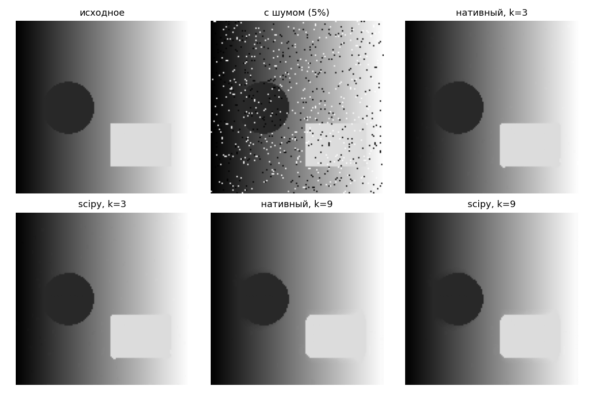
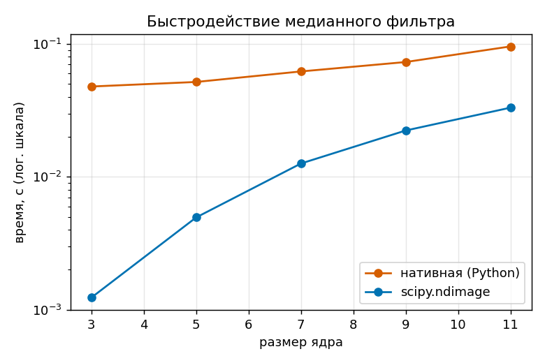

# ЛР1. Медианный фильтр с переменным размером ядра

## Реализация

- image_gen.py - тестовое изображение + шум "соль-перец"
- median_native.py - вложенные циклы, ручная сортировка окна
- median_lib.py - scipy.ndimage.median_filter
- benchmark.py, main.py - замер времени и сборка картинок/графиков

## Результаты

k=3 убирает почти весь шум, границы чёткие. k=9 убирает шум полностью,
но углы прямоугольника скругляются.

| k | нативная, с | scipy, с |
|---|---|---|
| 3 | 0.048 | 0.0012 |
| 5 | 0.052 | 0.0050 |
| 7 | 0.062 | 0.0126 |
| 9 | 0.073 | 0.0223 |
| 11 | 0.096 | 0.0332 |

При k=5 нативная и scipy версии совпадают почти везде, максимум отличие
пикселя - 2 из 255 (несовпадающих пикселей 0.07%, граница изображения).

## Выводы

scipy быстрее нативной реализации на любом k, но разрыв падает с 40x до 3x
при росте ядра. Чем больше ядро, тем сильнее убирается шум и тем заметнее
искажается геометрия объектов.

