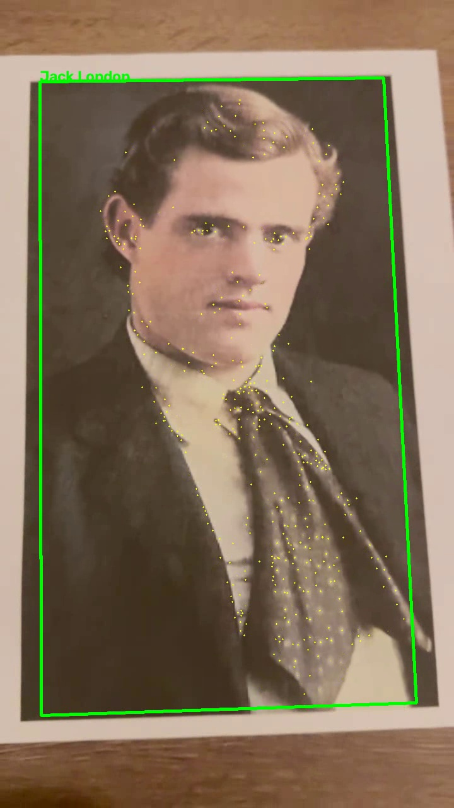
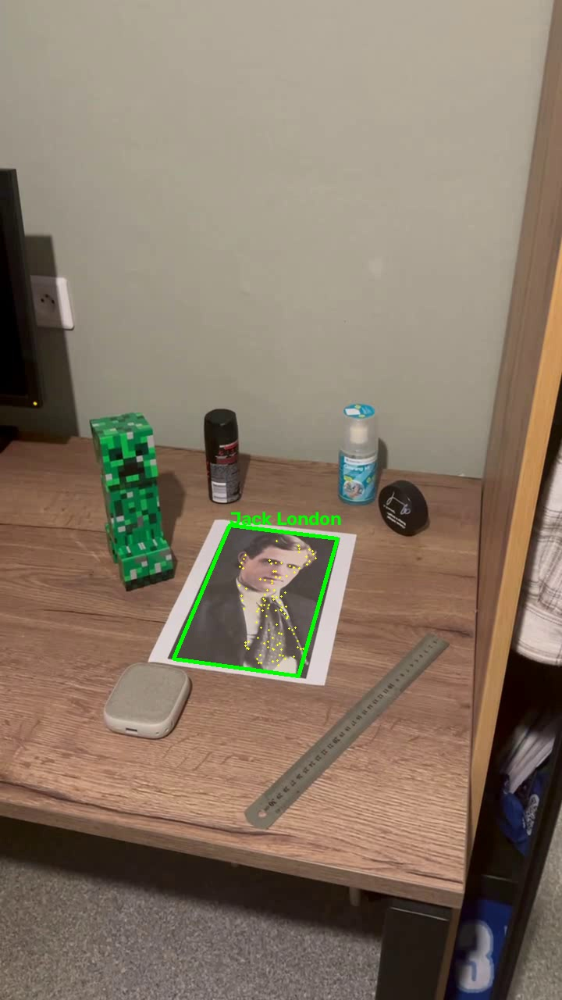
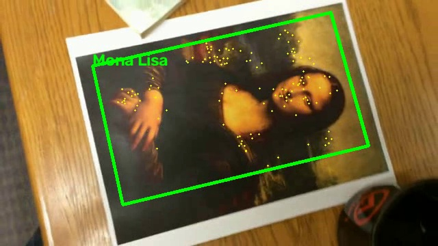
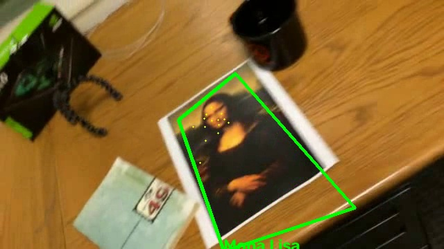
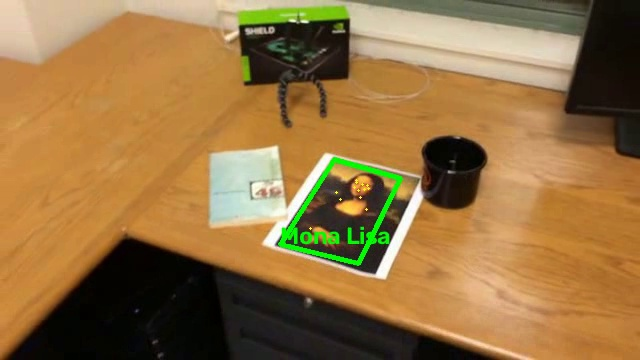
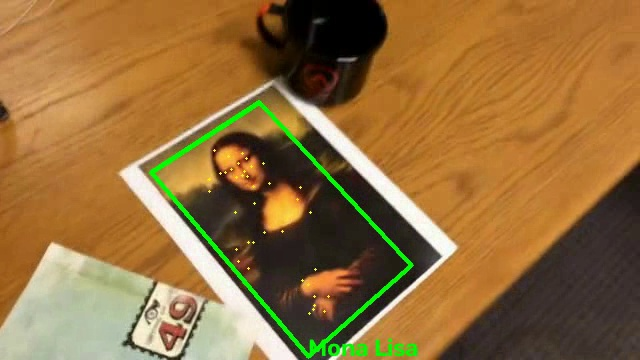
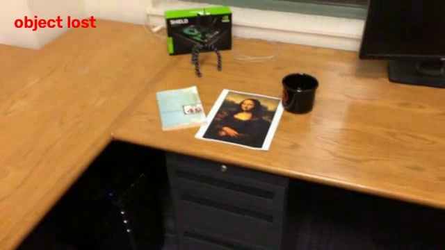

# ЛР2. Трекинг объекта по ключевым точкам

## Теоретическая база

Детектор SIFT находит ключевые точки на эталонном кадре и на текущем кадре, дескрипторы сопоставляются через BFMatcher с тестом отношения Лоу, по совпадениям через RANSAC считается гомография, углы эталона проецируются на кадр через cv2.perspectiveTransform.

Для устойчивости к углу съёмки эталон дополняется синтетическими перспективными искажениями исходного кадра (аналог ASIFT). Если совпадений не хватает (объект далеко, размыт, под острым углом), включается резерв - оптический поток Лукаса-Канаде (cv2.calcOpticalFlowPyrLK) переносит ранее найденные точки с предыдущего кадра на текущий.

## Описание разработанной системы

tracker.py - построение расширенного эталона, поиск по SIFT и гомографии, резервный оптический поток, проверки на вырожденный результат (невыпуклость, площадь, выход за кадр, рамка-игла).

main.py - первый кадр становится эталоном, остальные кадры по очереди проходят через tracker.py, на найденном объекте рисуется рамка с подписью, видео сохраняется в results/videos, в конце выводится статистика.

## Результаты работы и тестирования

| Видео | Кадров | Гомография | Поток | Потерян |
|---|---|---|---|---|
| video_jl.MOV (своё видео) | 517 | 100.0% | 0.0% | 0.0% |
| mona-lisa.avi | 557 | 61.2% | 38.8% | 0.0% |
| mona-lisa-blur.avi | 557 | 57.8% | 38.8% | 3.4% |
| mona-lisa-blur-extra-credit.avi | 557 | 54.4% | 10.6% | 35.0% |

Видео лежат в results/videos.

## Выводы

Связка SIFT с гомографией и оптическим потоком полностью решает задачу на собственном видео и на чистом видео преподавателя. На размытом видео теряется заметная часть кадров, а на самом тяжёлом варианте (сильное размытие плюс отдаление) - треть: здесь предел самого метода локальных признаков, а не реализации.

Рамка никогда не рисуется в виде вырожденного мусора - для этого добавлена проверка формы рамки, при провале объект честно помечается потерянным вместо неверной рамки.

## Использованные источники

Lowe D.G. Distinctive Image Features from Scale-Invariant Keypoints, 2004.

Morel J.M., Yu G. ASIFT: A New Framework for Fully Affine Invariant Image Comparison, 2009.

Документация OpenCV: SIFT, BFMatcher, findHomography, calcOpticalFlowPyrLK.
